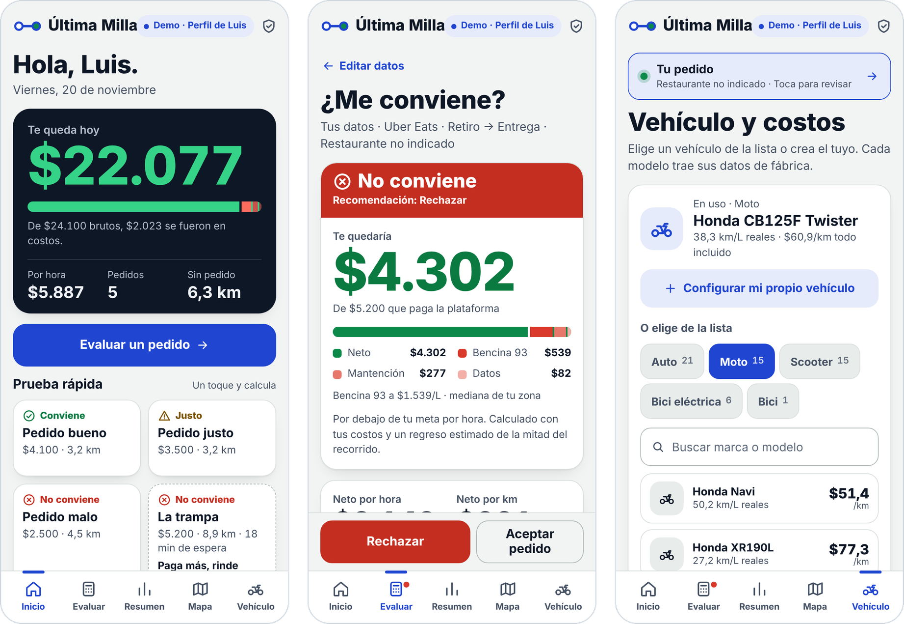

<div align="center">


# Última Milla

**How much does a delivery really leave you?**

A mobile web app for delivery riders in Chile. It takes what an order pays, subtracts what it costs to do it and tells you whether it is worth accepting.

[Open the live demo](https://c-rosende.github.io/ultima-milla/)

</div>

<picture>
  <source media="(prefers-color-scheme: dark)" srcset="docs/screens-dark.png">
  
</picture>

## What it does

Delivery platforms show what an order pays, not what it leaves. Última Milla works out the second number.

- **A verdict on every order.** Enter the payment and the distance, or tap one of the examples. The app subtracts fuel or electricity, maintenance, mobile data and an estimated trip back, then compares the result with your hourly goal: worth it, fair, or not worth it.
- **Your day, week and month.** Gross income, every cost and the net result, in one place.
- **Your own vehicle.** A catalogue of 58 cars, motorcycles, scooters and bikes common in Chile, each with real-world consumption. You can also enter your own.
- **Today's fuel price.** Prices come from the nearest station when you share your location, or from the median of your zone when you don't.
- **Works offline.** It installs on the phone like an app and keeps working without a connection.

The demo opens with a sample rider profile, so every screen has data from the first tap.

## How it is built

- **No framework, no build step, no dependencies.** Plain JavaScript modules, HTML and CSS, served as static files from GitHub Pages.
- **Pure logic, separate from the interface.** Costs and fuel prices are computed in modules with no DOM and no network access. The same price module runs in the browser and in the Node script that refreshes the data.
- **One source of truth per topic.** Every adjustable constant lives in `data/parametros.json` and every vehicle in `data/vehiculos.json`. Each vehicle entry cites where its consumption figure comes from, such as the official homologation data from Chile's Ministry of Energy.
- **Fuel prices with fallbacks.** The app tries, in order, a manual override, the nearest station, the live median of the zone, the daily snapshot and finally a fixed reference value, so it always has a number to work with.
- **Data that updates itself.** A scheduled GitHub Action pulls prices from about 1,750 stations every day, computes the median per zone and redeploys the site.
- **No account and no backend.** Settings and history stay in the browser's local storage. Routes are calculated with OSRM and maps use OpenStreetMap.
- **Tested.** 51 tests cover costs, prices, location, the vehicle catalogue, the route map and the data updater.

## Run it locally

You need any static file server and Node.js 22 or later for the tests.

```sh
python3 -m http.server 8000      # then open http://localhost:8000
node --test js/*.test.mjs route-map.test.js scripts/*.test.mjs
```

## Status

Working prototype, under active development.

## License

Copyright © 2026 Clemente Rosende. All rights reserved.

The source is public so the project can be reviewed. No permission is granted to copy, modify, distribute or use it, in whole or in part, without written consent.
